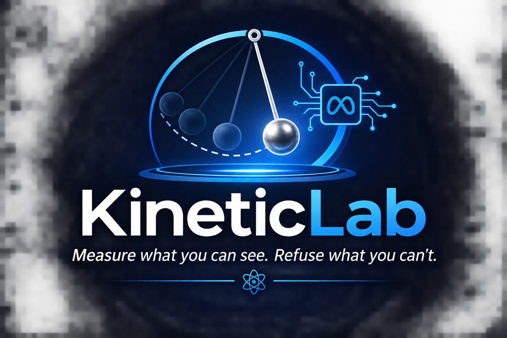
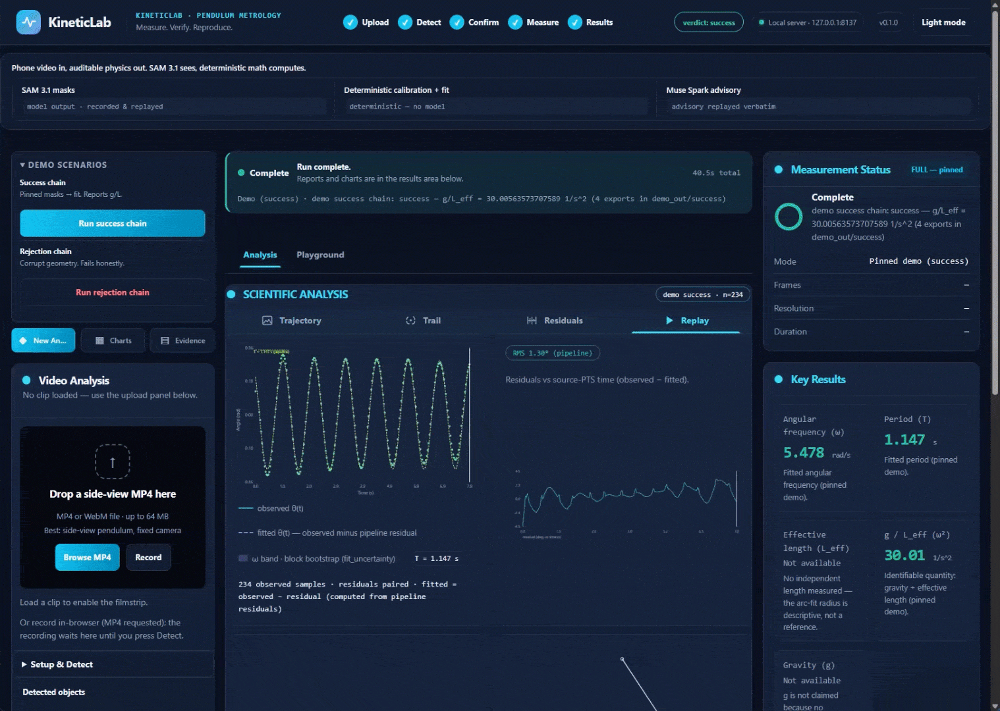
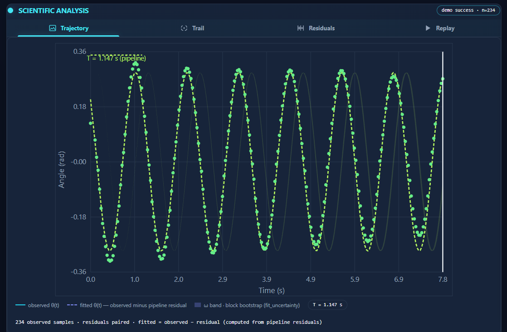
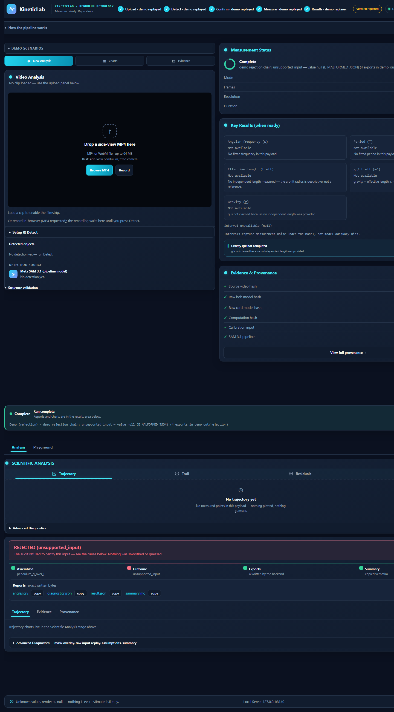

<div align="center">



**Point a phone camera at a swinging pendulum — Meta's SAM 3.1 model does the seeing, deterministic Python does the measuring, and every measurement ships with a full audit trail.**

     

<br>


<p align="center">
  
</p>

*Shown: the built-in demo replay. Every chart is the run's own measured data — rendered from that run's `angles.csv`, never baked, never illustrative.*

</div>

## Contents

| | |
|---|---|
| [What is KineticLab?](#what-is-kineticlab) | [Highlights](#highlights) |
| [How it works](#how-it-works) | [Meta models in the loop](#meta-models-in-the-loop) |
| [What a run looks like](#what-a-run-looks-like) | [What a run gives you](#what-a-run-gives-you) |
| [Why this is different](#why-this-is-different) | [Roadmap](#roadmap) |
| [Quickstart](#quickstart) | [Fields this touches](#fields-this-touches) |
| [Audit trail](#audit-trail) | [Docs](#docs) |
| [License](#license) | |

## What is KineticLab?

KineticLab turns an ordinary video clip into an **auditable measurement of a pendulum**. Meta **SAM 3.1** segments the bob and a reference card frame by frame; you confirm the masks; then a deterministic Python engine using a **stdlib-only runtime** fits the motion and reports `g/L_eff = ω²` (scale-free, `1/s²`) with a seeded block-bootstrap interval for ω. Optional `pytest` and build tooling are separate from runtime. Nothing is hidden between the pixels and the report: every stage keeps hashes, and every export carries full provenance.

The rule that shapes the whole project: **no model supplies or changes measurement values.** Vision output is untrusted telemetry, decoded by a canonical codec. Advisory text may echo exact JSON values only after audit and never feeds measurement assembly. When evidence is missing — no scale, no measured length — the answer is `null` with a registered warning code, never a guess dressed as data.

## Highlights

- **Video in, physics out** — measured θ(t) trajectory, fitted model, period, angular frequency ω, and `g/L_eff` with uncertainty
- **Gravity only from your own ruler** — type the pendulum length you measured yourself and the app computes `g = (g/L_eff) × L`; without it, `g` stays `null`
- **Honest nulls, loud rejections** — missing evidence renders `null` plus a warning; unusable clips fail with a specific red verdict, never a fake success
- **Exact-byte exports with a provenance chain** — input SHA-256, model name, artifact digests recorded on the result and summary exports; all four exports are written with exact, re-verifiable bytes
- **Nothing to install at runtime** — `dependencies = []`: Python 3.11+ stdlib runtime; optional `pytest` and build tooling stay separate

## How it works

Five stages, each one leaving evidence:

1. **Upload** — your clip, or the pinned demo. Variable-frame-rate video is parsed with source PTS preserved, never resynthesized.
2. **Detect** — Meta SAM 3.1 produces text-prompted bob/card masks per frame. Masks are stored verbatim and hash-pinned (the rail's optional Structure validation is a client-side pre-flight; Detect re-validates everything server-side).
3. **Confirm** — you review the masks before anything is measured.
4. **Measure** — deterministic calibration and fit: angles from the arc-fit pivot, ω via the pre-registered M1 estimator, uncertainty from a seeded block bootstrap.
5. **Results** — verdict, charts, exact-byte exports (`angles.csv`, `diagnostics.json`, `result.json`, `summary.md`), full provenance.

## Meta models in the loop

**Built with:** Meta SAM 3.1 · Spark advisory layer · deterministic Python stdlib runtime

| Model | Role | Guardrail |
|---|---|---|
| **Meta SAM 3.1** | Perception core: text-prompted bob/card masks per frame | Masks stored verbatim, hash-pinned, decoded by a canonical codec |
| **Spark (advisory layer)** | Offline-cached setup-review + narrative advisories | Number-echo audit: any narrative number not exactly justified by the JSON is discarded; never part of measurement assembly |

Meta AI does the seeing and the explaining. The **measurement itself stays deterministic** — that's the design. Full inventory with labeled live-run evidence: [`Docs/META_USAGE.md`](Docs/META_USAGE.md).

## What a run looks like

A successful run ends in a verdict, four exact-byte reports, and a provenance chain — input SHA-256, model name (`sam-3.1`), artifact digests, exports:

<p align="center">
  
</p>

The full-page view above shows the rest of the deck: residuals against source-PTS time, the centroid trail, and a replay that reconstructs the arm from the pinned masks with every playhead synced on the source-PTS timebase. Advanced diagnostics replay the pinned mask overlay frame by frame, state the model's assumptions verbatim — including what the uncertainty interval does and does not cover — and show the advisory narrative, labeled as a template, never a measurement.

The simulation playground unlocks only after a measurement seeds it: your measured `g/L_eff` drives a damped-pendulum toy over the measured trail, and the simulated clock never touches the measured timebase:

<p align="center">
  
</p>

## What a run gives you

| You provide | You get |
|---|---|
| Any clip + confirmed masks | `g/L_eff = ω²` (`1/s²`), period, amplitude, fit diagnostics, PTS-true angle CSV |
| + human-typed card width | mm-scale geometry: pivot, arc radius (descriptive) |
| + a length you measured yourself | gravity `g = (g/L_eff) × L` — computed only when the length is human-supplied; without it, `g` stays `null` |
| Nothing usable | A registered rejection — red, specific, and honest |

## Why this is different

Every AI demo can show a number. KineticLab is built so it **can't fake one**:

- **No model supplies or changes measurement values.** Vision output is untrusted telemetry — SAM 3.1 `one_bit` masks are stored verbatim with source PTS and decoded by a canonical codec. Advisory text may echo exact JSON values only after audit and never feeds measurement assembly. Physics is computed locally, deterministically.
- **Unknown is `null`.** Missing scale, length, or uncertainty renders as `null` plus an explicit warning code — never a guess dressed as data.
- **The card's millimeters are always human-typed** (`user_supplied`). The app never estimates mm from pixels.
- **Locked taxonomy.** Exactly 32 error codes and 9 warning codes in `kineticlab/contracts.py`; nothing new can appear at runtime; the one documented exception is unclassified server faults, which answer `code: null` rather than an invented code.
- **Rejection is never green.** Unsupported inputs fail loudly, with the same honesty as successes.

<p align="center">
  
</p>

- **Provenance on the result and summary exports:** `software_version`, `input_sha256`, `model_name`, artifact hashes of every written file — reproducible and auditable end-to-end; `angles.csv` and `diagnostics.json` are the exact-byte numeric exports.

## Roadmap

KineticLab is one instance of a pattern: **Meta models propose, deterministic physics disposes.** The pendulum is the first instrument on the bench. The same contract-checked, hash-pinned, honesty-law architecture generalizes to other mechanical systems — what changes is the fit model, never the discipline.

Designed next steps — stated as intent, not claims; none of it exists in the code today:

- **Multi-object tracking** — SAM 3.1 propagation over the rod and pivot, not just the bob and card. Deterministic rigidity checks (a stationary pivot, a non-stretching rod) would become additional *evidence* the pipeline verifies — not additional trust granted to the model.
- **Cross-model agreement** — a second Meta vision model (DINOv2-class) embeds each mask crop; agreement between two independently trained models becomes a recorded, auditable signal in the diagnostics.
- **Experiment Inspector** — a multimodal model examines the setup itself (lighting, scale reference, occlusions, camera motion) and files advisory notes. The pipeline keeps "model says" and "physics proves" in visibly separate channels, and only the latter can touch a verdict.
- **More experiments on the same rail** — spring-mass, projectile, collisions. The five-stage chain (upload → detect → confirm → measure → results) is experiment-agnostic; each new instrument is a new fit contract, with the same locked taxonomy, exact-byte exports, and honest nulls.

The destination is a **physics experiment hub**: a local laboratory where you film any mechanical system, Meta models do the seeing, and every measurement/result number survives an audit — because no model supplies or changes measurement values.

## Quickstart

```powershell
git clone https://github.com/localhost8083/kineticlab-neuro-symbolic-metrology.git
cd kineticlab-neuro-symbolic-metrology

python --version
python -m kineticlab --help
python scripts/media_check.py
python -m unittest          # 905 tests
python -m kineticlab serve  # localhost UI
```

| Command | What it does | Needs key? |
|---|---|---|
| `python -m kineticlab doctor` | Self-check: python version, contract integrity, fixture pins, node, key hygiene, config — one line per check, exit 1 on any FAIL | No |
| `python -m kineticlab demo` | Replays the pinned SAM + advisory artifacts, assembles one full chain, writes the four exact-byte exports — fully offline | No |
| `python -m kineticlab serve` | Starts the local web UI on 127.0.0.1 (blocking); uploads and results stay on your machine | No |
| `python -m kineticlab capture` | One live SAM capture + measure chain from your own clip | **Yes** — `MODEL_API_KEY` |
| `python -m kineticlab config` | Prints the effective non-secret configuration | No |
| `python scripts/media_check.py` | Offline media/fixture smoke check | No |
| `python -m unittest` | The full offline test suite | No |

The API key gates **live capture only** — it is sent solely as an `Authorization` header, never logged or stored. Without it, the demo, the UI, the certificate, and the entire suite still run offline from pinned fixtures.

**Cross-platform note.** The suite's byte pins prove *same-machine* replay determinism. OS C math libraries (glibc, UCRT) differ in the last ulp, which moves fit floats in the 8th+ decimal — a real numerical fact, not a bug. CI therefore runs the full suite on ubuntu + windows with the byte-pin tests skipped (`KL_CROSS_PLATFORM=1`) and UTF-8 text mode forced (`PYTHONUTF8=1`, the PEP 686 default). The pins stay strict on a single machine: rerun the suite twice locally and every hash matches.

## Fields this touches

- **Computer vision** — promptable segmentation of real, noisy, motion-blurred phone footage; VFR video parsing with source-PTS preservation
- **Metrology & instrumentation** — calibration from a human-anchored reference, uncertainty reporting, full provenance chains
- **Neuro-symbolic verification** — a locked code taxonomy + contract layer that makes hallucinated states unrepresentable
- **Trustworthy AI / honest UX** — null semantics, rejection states, no fake progress: an interface that never lies to stay pretty

## Audit trail

Built in the open with a two-agent workflow (builder + independent verifier) and two external audits. The audit's findings were verified against code and artifacts, triaged, and repaired — including executing the page's JavaScript in tests so runtime crashes of that class can't ship silently again. The internal process ledgers appear in no reachable commit of this repository: an early draft commit that once carried them was removed by a full-history rewrite, and GitHub’s object cache may still serve that orphaned draft’s page by its direct SHA until garbage collection. What’s here is the product and its evidence.

<details>
<summary><b>Overview & promo material</b> (marketing graphics — mock values are illustrative, the app's own numbers are not)</summary>

<p align="center">
  
</p>
<p align="center">
  
</p>
<p align="center">
  
</p>

</details>

## Docs

- [Demo runbook](Docs/Demo_Runbook.md) — reproduce every demo
- [Reproduce the pipeline](Docs/REPRODUCE.md)
- [Overview](Docs/OVERVIEW.md)
- [Meta model usage](Docs/META_USAGE.md) — the full model inventory with labeled evidence

## License

MIT — see [LICENSE](LICENSE).
