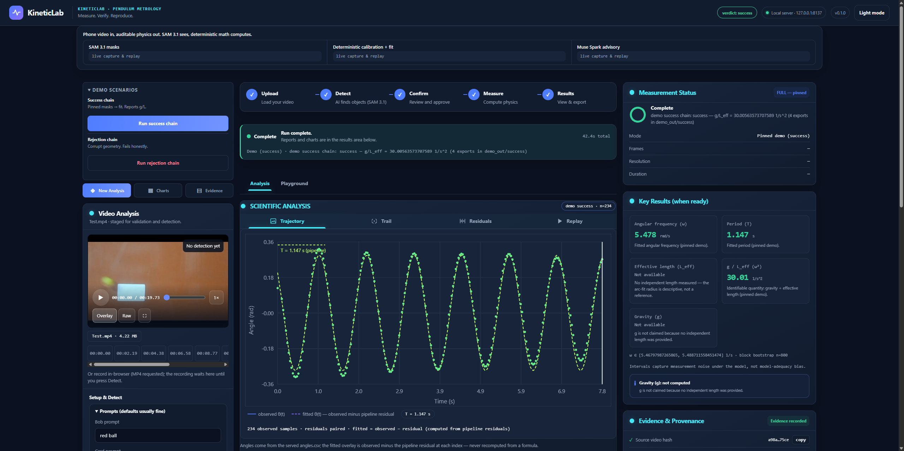
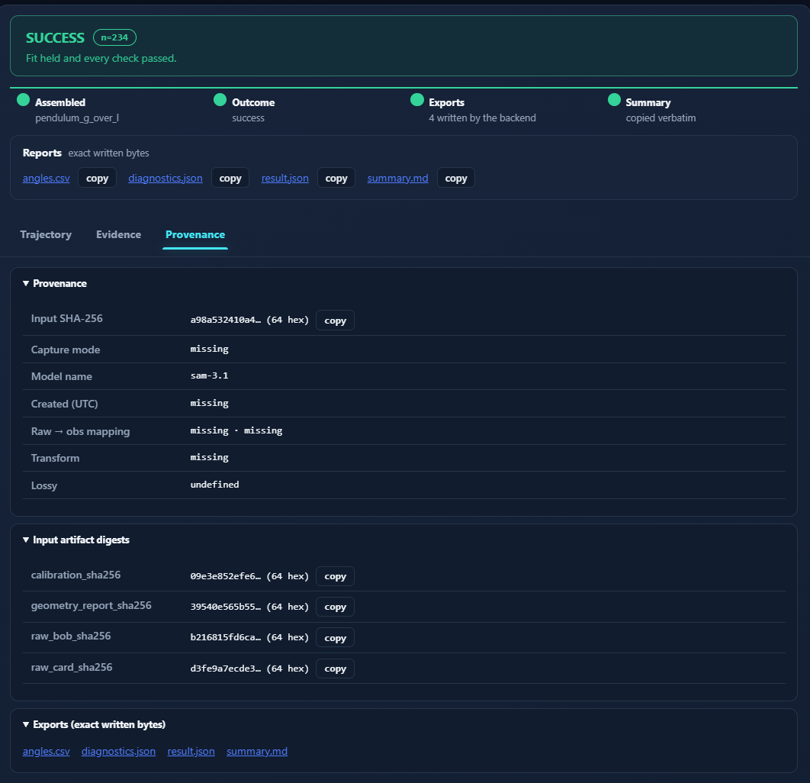
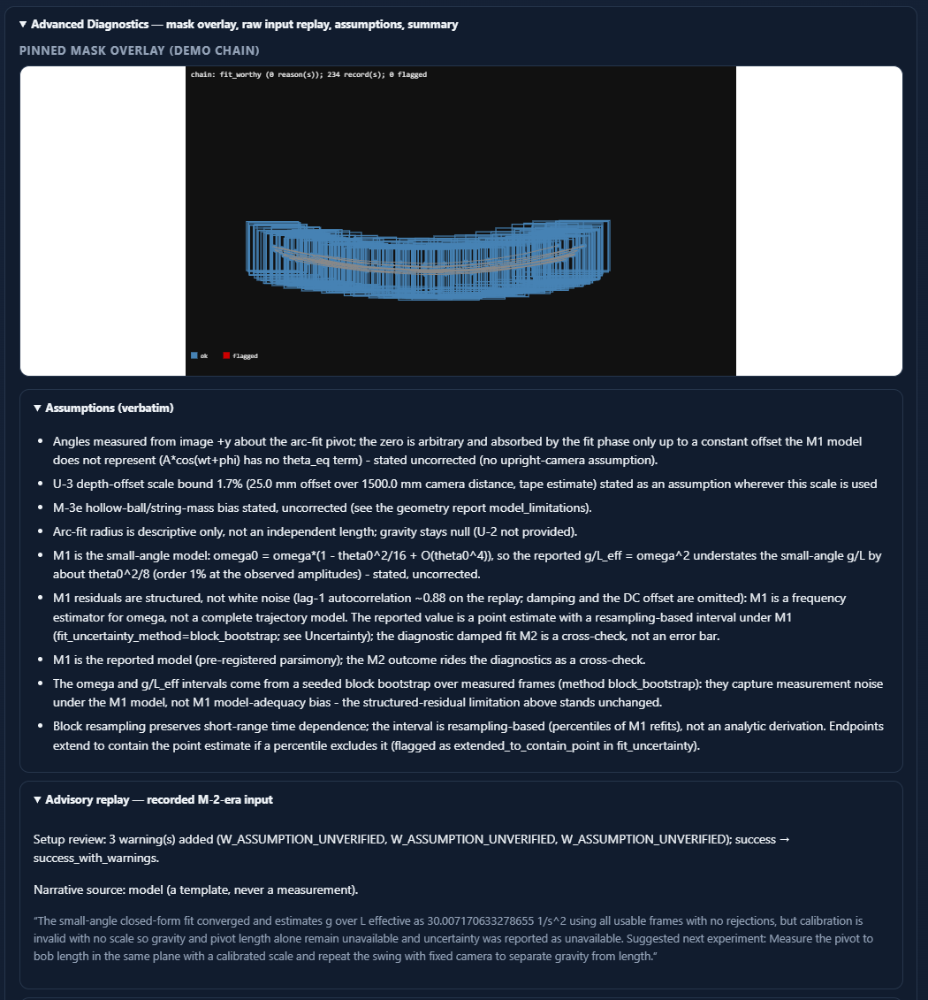
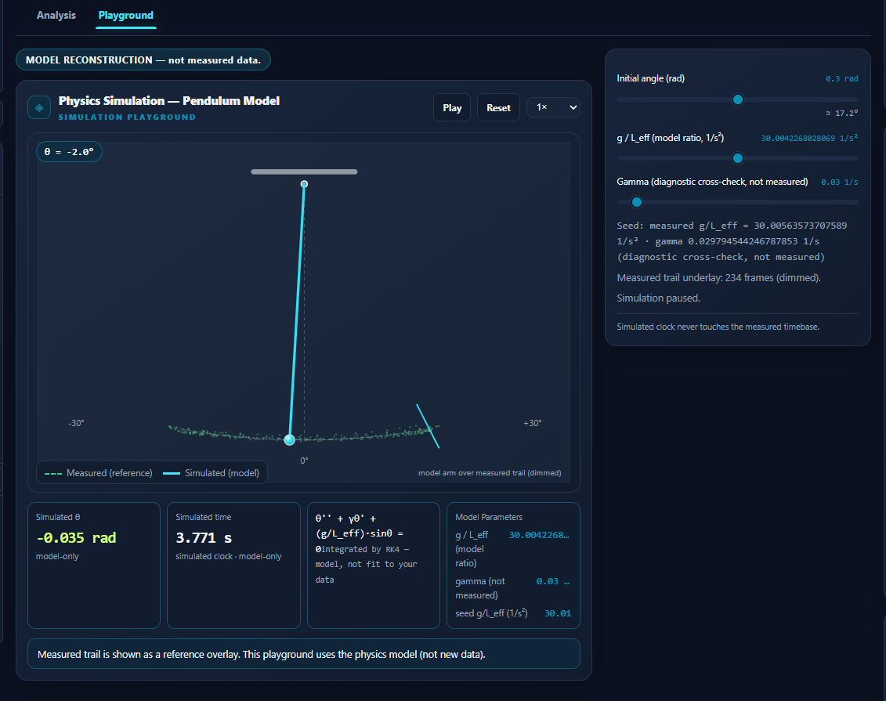

<div align="center">

# KineticLab

**Point a phone camera at a swinging pendulum — Meta's SAM 3.1 model does the seeing, deterministic Python does the measuring, and every number ships with a full audit trail.**

     

<br>



*Shown: the built-in demo replay. Every chart is the run's own measured data — rendered from that run's `angles.csv`, never baked, never illustrative.*

</div>

## Contents

| | |
|---|---|
| [What is KineticLab?](#what-is-kineticlab) | [Highlights](#highlights) |
| [How it works](#how-it-works) | [Meta models in the loop](#meta-models-in-the-loop) |
| [What a run looks like](#what-a-run-looks-like) | [What a run gives you](#what-a-run-gives-you) |
| [Why this is different](#why-this-is-different) | [Quickstart](#quickstart) |
| [Fields this touches](#fields-this-touches) | [Audit trail](#audit-trail) |
| [Docs](#docs) | [License](#license) |

## What is KineticLab?

KineticLab turns an ordinary video clip into an **auditable measurement of a pendulum**. Meta **SAM 3.1** segments the bob and a reference card frame by frame; you confirm the masks; then a deterministic, **stdlib-only** Python engine fits the motion and reports `g/L_eff = ω²` (scale-free, `1/s²`) with a seeded block-bootstrap interval for ω. Nothing is hidden between the pixels and the report: every stage keeps hashes, and every export carries full provenance.

The rule that shapes the whole project: **no language model ever authors a number.** Vision output is untrusted telemetry, decoded by a canonical codec. When evidence is missing — no scale, no measured length — the answer is `null` with a registered warning code, never a guess dressed as data.

## Highlights

- **Video in, physics out** — measured θ(t) trajectory, fitted model, period, angular frequency ω, and `g/L_eff` with uncertainty
- **Gravity only from your own ruler** — type the pendulum length you measured yourself and the app computes `g = (g/L_eff) × L`; without it, `g` stays `null`
- **Honest nulls, loud rejections** — missing evidence renders `null` plus a warning; unusable clips fail with a specific red verdict, never a fake success
- **Full provenance on every export** — input SHA-256, model name, artifact digests, exact written bytes you can re-verify
- **Nothing to install** — `dependencies = []`: pure Python 3.11+ stdlib; clone and run

## How it works

Five stages, each one leaving evidence:

1. **Upload** — your clip, or the pinned demo. Variable-frame-rate video is parsed with source PTS preserved, never resynthesized.
2. **Detect** — Meta SAM 3.1 produces text-prompted bob/card masks per frame. Masks are stored verbatim and hash-pinned.
3. **Confirm** — you review the masks before anything is measured.
4. **Measure** — deterministic calibration and fit: angles from the arc-fit pivot, ω via the pre-registered M1 estimator, uncertainty from a seeded block bootstrap.
5. **Results** — verdict, charts, exact-byte exports (`angles.csv`, `diagnostics.json`, `result.json`, `summary.md`), full provenance.

## Meta models in the loop

| Model | Role | Guardrail |
|---|---|---|
| **Meta SAM 3.1** | Perception core: text-prompted bob/card masks per frame | Masks stored verbatim, hash-pinned, decoded by a canonical codec |
| **Spark (advisory layer)** | Offline-cached setup-review + narrative advisories | Number-echo audit: any narrative number not exactly justified by the JSON is discarded |

Meta AI does the seeing and the explaining. The **measurement itself stays deterministic** — that's the design. Full inventory with labeled live-run evidence: [`Docs/META_USAGE.md`](Docs/META_USAGE.md).

## What a run looks like

A successful run ends in a verdict, four exact-byte reports, and a provenance chain — input SHA-256, model name (`sam-3.1`), artifact digests, exports:

<p align="center">
  
</p>

Advanced diagnostics replay the pinned mask overlay frame by frame, state the model's assumptions verbatim — including what the uncertainty interval does and does not cover — and show the advisory narrative, labeled as a template, never a measurement:

<p align="center">
  
</p>

The simulation playground unlocks only after a measurement seeds it: your measured `g/L_eff` drives a damped-pendulum toy over the measured trail, and the simulated clock never touches the measured timebase:

<p align="center">
  
</p>

## What a run gives you

| You provide | You get |
|---|---|
| Any clip + confirmed masks | `g/L_eff = ω²` (`1/s²`), period, amplitude, fit diagnostics, PTS-true angle CSV |
| + human-typed card width | mm-scale geometry: pivot, arc radius (descriptive) |
| + a length you measured yourself | gravity `g = (g/L_eff) × L` — computed only when the length is human-supplied; without it, `g` stays `null` |
| Nothing usable | A registered rejection — red, specific, and honest |

## Why this is different

Every AI demo can show a number. KineticLab is built so it **can't fake one**:

- **No language model ever authors a number.** Vision output is untrusted telemetry — SAM 3.1 `one_bit` masks are stored verbatim with source PTS and decoded by a canonical codec. Physics is computed locally, deterministically.
- **Unknown is `null`.** Missing scale, length, or uncertainty renders as `null` plus an explicit warning code — never a guess dressed as data.
- **The card's millimeters are always human-typed** (`user_supplied`). The app never estimates mm from pixels.
- **Locked taxonomy.** Exactly 32 error codes and 9 warning codes in `kineticlab/contracts.py`; nothing new can appear at runtime; the one documented exception is unclassified server faults, which answer `code: null` rather than an invented code.
- **Rejection is never green.** Unsupported inputs fail loudly, with the same honesty as successes.
- **Every export carries provenance:** `software_version`, `input_sha256`, `model_name`, artifact hashes — reproducible and auditable end-to-end.

## Quickstart

```powershell
git clone https://github.com/localhost8083/kineticlab-neuro-symbolic-metrology.git
cd kineticlab-neuro-symbolic-metrology

python --version
python -m kineticlab --help
python scripts/media_check.py
python -m unittest          # 871 tests
python -m kineticlab serve  # localhost UI
```

Live capture needs `MODEL_API_KEY` in the environment — sent only as an `Authorization` header, never logged or stored. Without it, the live panel degrades honestly (503 + registered code).

**Cross-platform note.** The suite's byte pins prove *same-machine* replay determinism. OS C math libraries (glibc, UCRT) differ in the last ulp, which moves fit floats in the 8th+ decimal — a real numerical fact, not a bug. CI therefore runs the full suite on ubuntu + windows with the byte-pin tests skipped (`KL_CROSS_PLATFORM=1`) and UTF-8 text mode forced (`PYTHONUTF8=1`, the PEP 686 default). The pins stay strict on a single machine: rerun the suite twice locally and every hash matches.

## Fields this touches

- **Computer vision** — promptable segmentation of real, noisy, motion-blurred phone footage; VFR video parsing with source-PTS preservation
- **Metrology & instrumentation** — calibration from a human-anchored reference, uncertainty reporting, full provenance chains
- **Neuro-symbolic verification** — a locked code taxonomy + contract layer that makes hallucinated states unrepresentable
- **Trustworthy AI / honest UX** — null semantics, rejection states, no fake progress: an interface that never lies to stay pretty

## Audit trail

Built in the open with a two-agent workflow (builder + independent verifier) and two external audits. The audit's findings were verified against code and artifacts, triaged, and repaired — including executing the page's JavaScript in tests so runtime crashes of that class can't ship silently again. The internal process ledgers are kept out of the public repo by design; what's here is the product and its evidence.

<details>
<summary><b>Overview & promo material</b> (marketing graphics — mock values are illustrative, the app's own numbers are not)</summary>

<p align="center">
  
</p>
<p align="center">
  
</p>
<p align="center">
  
</p>

</details>

## Docs

- [Demo runbook](Docs/Demo_Runbook.md) — reproduce every demo
- [Reproduce the pipeline](Docs/REPRODUCE.md)
- [Overview](Docs/OVERVIEW.md)
- [Meta model usage](Docs/META_USAGE.md) — the full model inventory with labeled evidence

## License

MIT — see [LICENSE](LICENSE).
