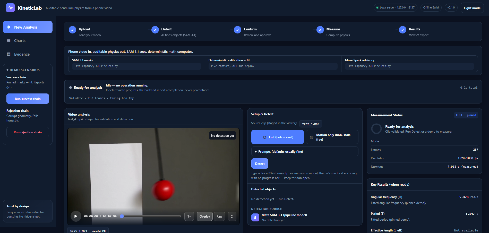
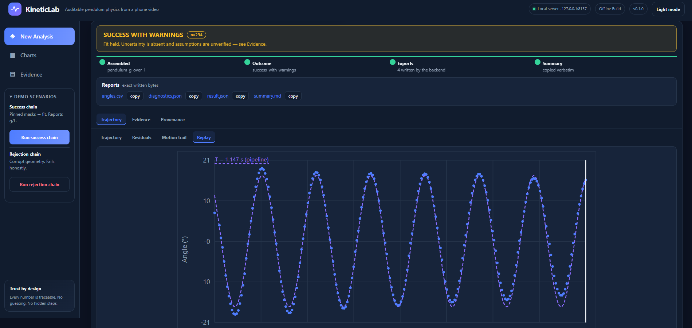
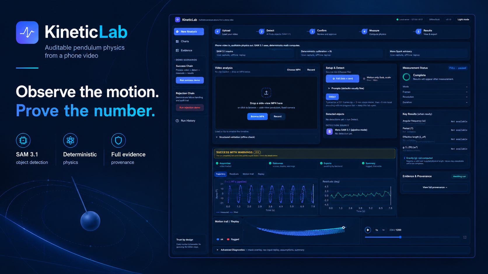
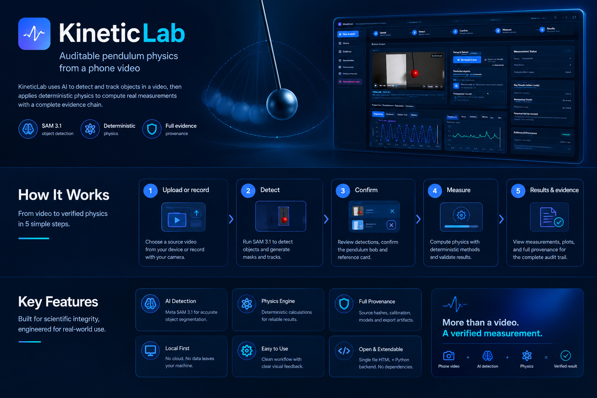
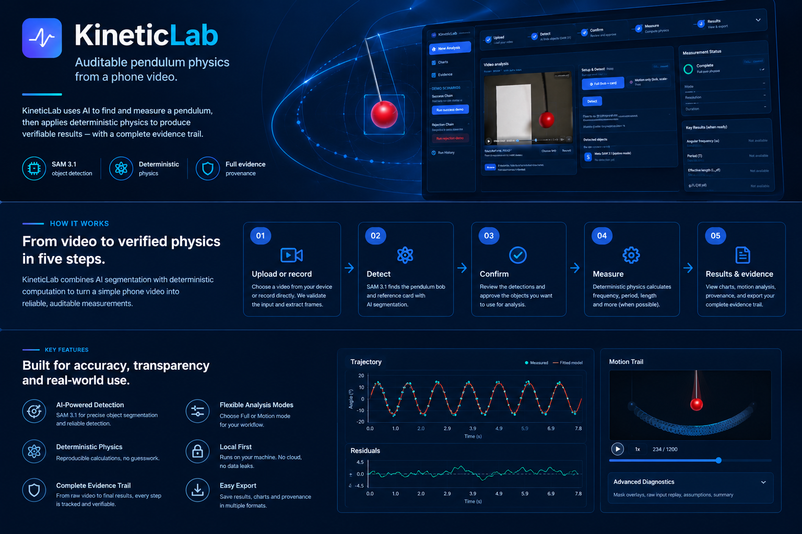

# KineticLab

**Point a phone camera at a pendulum. Get honest physics out.**

KineticLab turns an ordinary video clip into an auditable measurement: Meta **SAM 3.1** segments the bob and reference card frame-by-frame, and a deterministic, **stdlib-only** Python engine turns those masks into `g/L_eff` (scale-free, `1/s²`) — with gravity `g` deliberately left `null`: today’s build has no length input, so the gated gravity step is future work, not a hidden promise. When evidence is missing, the answer is `null` with a registered warning — never a guess.

<p align="center">
  
</p>

     

**Cross-platform note.** The suite's byte pins prove *same-machine* replay determinism. OS C math libraries (glibc, UCRT) differ in the last ulp, which moves fit floats in the 8th+ decimal — a real numerical fact, not a bug. CI therefore runs the full suite on ubuntu + windows with the byte-pin tests skipped (`KL_CROSS_PLATFORM=1`) and UTF-8 text mode forced (`PYTHONUTF8=1`, the PEP 686 default). The pins stay strict on a single machine: rerun the suite twice locally and every hash matches.

**Every chart is the run's own data.** The trajectory below is the measured θ(t) from a real 234-frame clip (blue dots) against the fitted model — rendered from that run's `angles.csv`, never baked, never illustrative:

<p align="center">
  
</p>

<details>
<summary><b>Overview & promo material</b> (marketing graphics — mock values are illustrative, the app's own numbers are not)</summary>

<p align="center">
  
</p>
<p align="center">
  
</p>
<p align="center">
  
</p>

</details>

## Why this is different

Every AI demo can show a number. KineticLab is built so it **can't fake one**:

- **No language model ever authors a number.** Vision output is untrusted telemetry — SAM 3.1 `one_bit` masks are stored verbatim with source PTS and decoded by a canonical codec. Physics is computed locally, deterministically.
- **Unknown is `null`.** Missing scale, length, or uncertainty renders as `null` plus an explicit warning code — never a guess dressed as data.
- **The card's millimeters are always human-typed** (`user_supplied`). The app never estimates mm from pixels.
- **Locked taxonomy.** Exactly 32 error codes and 9 warning codes in `kineticlab/contracts.py`; nothing new can appear at runtime; the one documented exception is unclassified server faults, which answer `code: null` rather than an invented code.
- **Rejection is never green.** Unsupported inputs fail loudly, with the same honesty as successes.
- **Every export carries provenance:** `software_version`, `input_sha256`, `model_name`, artifact hashes — reproducible and auditable end-to-end.

## Meta models in the loop

| Model | Role | Guardrail |
|---|---|---|
| **Meta SAM 3.1** | Perception core: text-prompted bob/card masks per frame | Masks stored verbatim, hash-pinned, decoded by a canonical codec |
| **Spark (advisory layer)** | Offline-cached setup-review + narrative advisories | Number-echo audit: any narrative number not exactly justified by the JSON is discarded |

Meta AI does the seeing and the explaining. The **measurement itself stays deterministic** — that's the design. Full inventory with labeled live-run evidence: [`Docs/META_USAGE.md`](Docs/META_USAGE.md).

## Fields this touches

- **Computer vision** — promptable segmentation of real, noisy, motion-blurred phone footage; VFR video parsing with source-PTS preservation
- **Metrology & instrumentation** — calibration from a human-anchored reference, uncertainty reporting, full provenance chains
- **Neuro-symbolic verification** — a locked code taxonomy + contract layer that makes hallucinated states unrepresentable
- **Trustworthy AI / honest UX** — null semantics, rejection states, no fake progress: an interface that never lies to stay pretty

## Quickstart

```powershell
git clone https://github.com/localhost8083/kineticlab-neuro-symbolic-metrology.git
cd kineticlab-neuro-symbolic-metrology

python --version
python -m kineticlab --help
python scripts/media_check.py
python -m unittest          # 854 tests
python -m kineticlab serve  # localhost UI
```

Live capture needs `MODEL_API_KEY` in the environment — sent only as an `Authorization` header, never logged or stored. Without it, the live panel degrades honestly (503 + registered code).

## What a run gives you

| You provide | You get |
|---|---|
| Any clip + confirmed masks | `g/L_eff = ω²` (`1/s²`), period, amplitude, fit diagnostics, PTS-true angle CSV |
| + human-typed card width | mm-scale geometry: pivot, arc radius (descriptive) |
| + independently measured length | gravity `g` — **not in this build**: `g/L_eff` is measured, but no length input exists yet, so `g` stays `null` (planned: the gated `g = (g/L) × L` step) |
| Nothing usable | A registered rejection — red, specific, and honest |

## Audit trail

Built in the open with a two-agent workflow (builder + independent verifier) and two external audits. The audit's findings were verified against code and artifacts, triaged, and repaired — including executing the page's JavaScript in tests so runtime crashes of that class can't ship silently again. The internal process ledgers are kept out of the public repo by design; what's here is the product and its evidence.

## Docs

- [Demo runbook](Docs/Demo_Runbook.md) — reproduce every demo
- [Reproduce the pipeline](Docs/REPRODUCE.md)
- [Overview](Docs/OVERVIEW.md)

## License

MIT — see [LICENSE](LICENSE).
